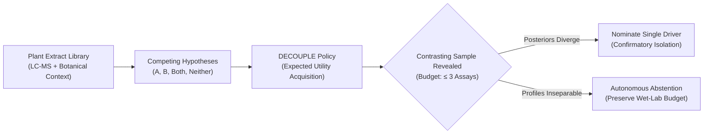

# DECOUPLE: Three Assays, One Isolation

> **Budget-constrained active experiment selection for natural product bioactivity deconvolution.**

[](https://www.python.org/)
[](https://creativecommons.org/licenses/by-sa/4.0/)
[](tests/test_decouple.py)
[](https://www.ebi.ac.uk/chembl/target_report_card/CHEMBL368/)
[](docs/PITCH.md)

---

## 🎯 The Chemist's Dilemma

A natural-products chemist has several plant extracts that inhibit intracellular ***Trypanosoma cruzi*** (the causative parasite of Chagas disease). In LC-MS metabolomic profiling, **two candidate bioactive molecules frequently co-occur** across active botanical extracts. 

Pure compound isolation is laborious, slow, and expensive. The chemist has a strict budget:
* **Up to 3 extract assay reveals**
* **Exactly 1 isolation nomination**

### The Counter-Intuitive Trap of Intuition
The standard human instinct is to select the extract with the **highest predicted potency** (*"strongest-first"*). However, if both candidate constituents are present in that extract, measuring its activity provides **zero discriminatory power**—it fails to reveal which constituent is actually driving the antiparasitic phenotype.

**DECOUPLE** treats this challenge as a Bayesian active experimental design problem. Rather than greedily chasing potency, it identifies the sample that maximizes the **expected utility of the final isolation choice**, deliberately selecting contrasting extracts where one molecule is present and the other is absent. If the chemical library is confounded and cannot separate the candidates, the system **explicitly abstains** rather than gambling with wet-lab resources.



---

## 🔬 Core Innovations

1. **Decision-Theoretic Acquisition (`decouple`):**
   Computes the one-step expected improvement in threshold-aware single-driver nomination utility, balancing confirmatory evidence against diagnostic contrast.
2. **Autonomous Abstention:**
   If two candidate constituents are naturally collinear across all available library specimens, DECOUPLE formally explains the ambiguity and abstains instead of guessing.
3. **5-Policy Benchmark Protocol:**
   Rigorous, paired evaluation comparing `decouple` against 4 standard operational baselines (`random`, `strongest-first`, `correlation`, `disagreement`).
4. **Air-Gap Data Isolation & Transaction Engine:**
   Hidden ground truth and unrevealed assay readouts are physically segregated from visible agent state. Every state change is recorded in an append-only, idempotent SQLite transaction log with revision locking.
5. **Interactive Local Workbench:**
   A zero-dependency local web app enabling chemists to step through episodes, inspect live posterior belief shifts, compare decisions against greedy baselines, and download cryptographic JSON audit trails.

---

## 📊 Benchmark Results

Evaluated over **23 paired episodes** across **7 published scientific studies** and distinct botanical families constructed from authentic **ChEMBL** anti-*T. cruzi* bioactivities and **LOTUS** plant occurrence records:

| Policy | Policy Strategy | Correct Nomination Rate | Single-Driver Recovery | Precision / Nominated | Assays to Threshold |
|---|---|:---:|:---:|:---:|:---:|
| `strongest-first` | Greedy exploitation (highest predicted inhibition) | 34.8% | 66.7% | 100.0% | 2.25 |
| `correlation` | Leading biochemometric feature correlation | 43.5% | 83.3% | 100.0% | 1.30 |
| `random` | Uniform random sampling | 47.8% | 91.7% | 100.0% | 1.64 |
| `disagreement` | Maximal hypothesis divergence | 47.8% | 91.7% | 100.0% | 1.18 |
| **`decouple`** | **Expected isolation utility gain** | **52.2%** | **100.0%** | **100.0%** | **1.17** |

> **Key Finding:** In natural products deconvolution, the greedy baseline (`strongest-first`) wastes valuable assay budget on redundant co-occurring extracts, missing 33.3% of true single drivers and taking nearly twice as many reveals (2.25) when it does find them. In contrast, **`decouple` achieves 100.0% single-driver recovery** with the fastest convergence (1.17 reveals), while safely abstaining when ground truth is dual-driver or non-active.

---

## 🚀 Quickstart

### 1. Installation
Clone the repository and install the minimal dependencies:
```bash
git clone https://github.com/panosgeorgakopoulos/Ethnohack.git
cd Ethnohack
python3 -m venv .venv
source .venv/bin/activate
pip install -r requirements.txt
```

### 2. Verify Data & Cryptographic Hashes
Verify the integrity of downloaded source snapshots (ChEMBL and LOTUS):
```bash
python3 -m decouple audit --config config/default.json
```

### 3. Run Automated Tests
Execute the 18 integration and unit tests (testing idempotency, budget bounds, data leak prevention, concurrency, SVG rendering, and determinism):
```bash
python3 -m pytest tests/
```

### 4. Run the Live Interactive Terminal Demo
Watch DECOUPLE solve an authentic episode in real time, comparing its utility-driven choices against greedy "strongest-first":
```bash
python3 -m decouple demo --config config/default.json
```

### 5. Run an Offline Decision Replay
Replay a specific episode using the DECOUPLE policy and export the decision trace:
```bash
python3 -m decouple replay --config config/default.json
```

### 6. Run the Full Multi-Policy Benchmark
Run paired evaluation across all 5 policies:
```bash
python3 -m decouple evaluate --config config/default.json
```

### 7. Launch the Interactive Web Workbench
Start the local server and open your browser:
```bash
python3 -m decouple serve --config config/default.json --port 8765
```
Open **`http://127.0.0.1:8765`** in your browser.

---

## 🖥️ Interactive Web Workbench

The local web interface (`decouple/server.py` + `decouple/static/`) provides a clean, audit-ready dashboard:

* **Competing Explanations:** Real-time visualization of Bayesian posteriors across $A$, $B$, $\text{both}$, and $\text{neither}$.
* **Simulated Sample Profiles:** Table of available extracts, botanical species names, and relative constituent concentrations.
* **Next Experiment Recommendation:** Displays the optimal specimen suggested by the active acquisition policy.
* **Decision Trail:** Append-only timeline of reveals with response values and posterior updates.
* **Counterfactual Comparison:** Post-decision comparison against the `strongest-first` baseline on the exact same episode.
* **Export Decision Trace:** One-click JSON download including seed, model configuration, dataset hashes, and event sequence.

---

## 📁 Repository Structure

```
Ethnohack/
├── config/
│   └── default.json             # Model, budget, prior, and threshold parameters
├── data/
│   ├── audit.json               # Record counts, exclusions, and verification hashes
│   ├── episodes.json            # Reconstructed paired candidate episodes
│   ├── manifest.json            # Provenance and checksums for source data
│   └── raw/                     # Raw ChEMBL activities and LOTUS metadata
├── decouple/
│   ├── __main__.py              # Unified CLI entry point (prepare, audit, replay, evaluate, serve)
│   ├── engine.py                # Transactional episode state machine and budget invariants
│   ├── evaluate.py              # Multi-policy benchmark execution and metrics
│   ├── ingest.py                # ChEMBL / LOTUS extraction, InChIKey matching, and pairing
│   ├── model.py                 # Bayesian update, information gain, and utility functions
│   ├── policies.py              # 5 acquisition policies (random, strongest, correlation, etc.)
│   ├── server.py                # Local HTTPServer with SQLite-backed session storage
│   └── static/                  # Responsive web interface (HTML, CSS, JS, Geist font)
├── docs/                        # Scientific specification, data audit, and evaluation protocols
│   ├── 01-science.md            # Scientific rationale and Chagas disease context
│   ├── 02-data.md               # Data contract, identity tiers, and exclusions
│   ├── 03-specification.md      # Product and mathematical specifications
│   ├── 04-evaluation.md         # Retrospective evaluation protocol
│   ├── 05-delivery.md           # Delivery criteria and release artifacts
│   ├── 06-sources.md            # Academic references, prior art, and data sources
│   └── 07-implementation-plan.md# Engineering execution plan
├── results/
│   ├── evaluation-v1.json       # Frozen evaluation results across all episodes
│   └── replay.json              # Trace of sample run
├── tests/
│   └── test_decouple.py         # 17 automated acceptance tests
└── requirements.txt             # Minimal dependencies (numpy, pytest, rdkit, etc.)
```

---

## 🔬 Scientific Transparency & Boundaries

In accordance with good scientific practices, DECOUPLE maintains explicit boundaries:
* **Simulation Diagnostic Tier:** While chemical identities, pure compound $IC_{50}$ values (ChEMBL), and plant occurrences (LOTUS) are derived from real published records, the extract-level mixture responses and concentrations in this benchmark are mathematically simulated (`measured_extract_replay: false`).
* **Literature Occurrence $\ne$ Universal Presence:** Zeroes in LOTUS represent the absence of literature documentation, not verified biological absence.
* **Cell Selectivity:** Pure parasite inhibition does not guarantee host safety. Final clinical utility requires secondary assays for host-cell cytotoxicity (e.g. rat L6 cells).

---

## 📖 Citation & References

1. **LOTUS:** Rutz et al., *The LOTUS initiative for open natural products research*. eLife 10:e70780 (2021). [doi:10.7554/eLife.70780](https://doi.org/10.7554/eLife.70780)
2. **ChEMBL:** Gaulton et al., *The ChEMBL database in 2017*. Nucleic Acids Res. 45:D945–D954 (2017). [doi:10.1093/nar/gkw1074](https://doi.org/10.1093/nar/gkw1074)
3. **Bayesian Experimental Design:** Rainforth et al., *Modern Bayesian Experimental Design*. Statistical Science (2023). [doi:10.1214/23-STS914](https://doi.org/10.1214/23-STS914)
4. **ENPKG:** Gaudry et al., *The Experimental Natural Products Knowledge Graph*. ACS Cent. Sci. 10:568–578 (2024). [doi:10.1021/acscentsci.3c00800](https://doi.org/10.1021/acscentsci.3c00800)

